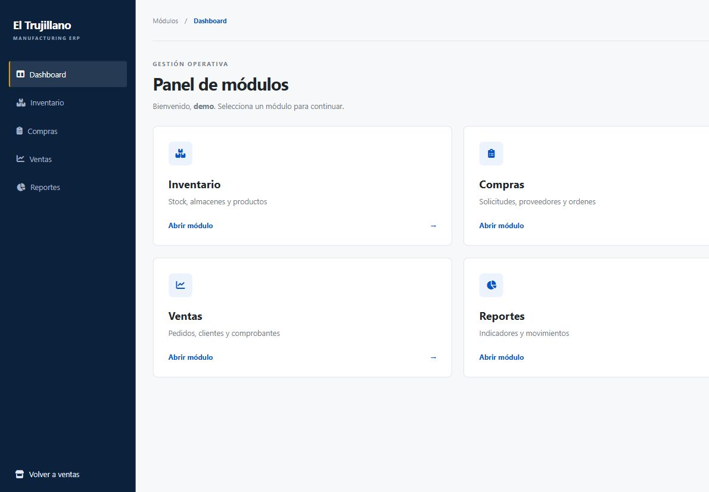
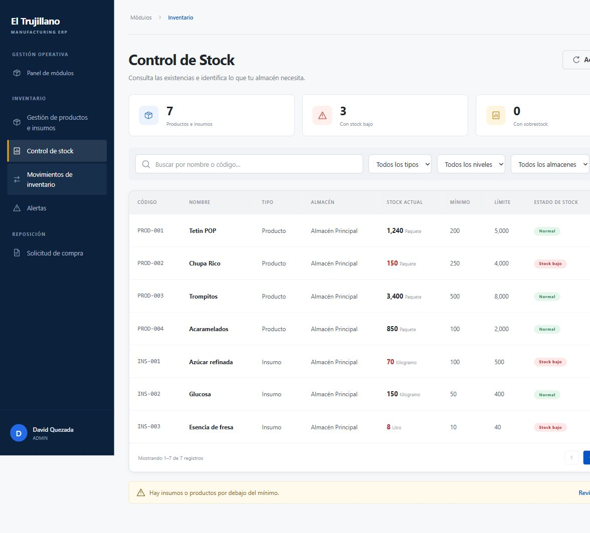

# Revisión de backend, frontend y dashboard

3 de noviembre de 2026.

El código Angular está ahora en `C:/Users/jatni/Downloads/TrujillanosSAC-Frontend`, como proyecto hermano del backend. Su compilación se integra en `src/main/resources/static/inventario-app`.

Se corrigió `scripts/integrar-backend.mjs` del frontend: la ruta anterior, después de mover la carpeta, apuntaba a `Downloads/src` en lugar del backend. Se ampliaron las rutas del proxy de desarrollo para dirigir `/admin`, `/ventas`, `/proveedor`, `/login` y `/logout` al backend, además de `/api`, `/img` y `/uploads`.

El dashboard usa Thymeleaf y el inventario usa Angular. La plantilla `admin/modulo.html` era una pantalla provisional. Ahora presenta accesos a los módulos autorizados por el servidor, con la paleta azul, barra lateral de 250 px, cabecera, tipografía y espaciado del inventario. Incluye cierre de sesión mediante POST con CSRF. Las tarjetas respetan los permisos existentes. El diseño adapta las tarjetas a una columna en móvil y mantiene visibles los accesos del panel.

Validación realizada:

- Frontend: `npm run check` y `npm run build:backend` correctos desde su ubicación nueva.
- Backend: `mvnw.cmd -o test`, 20 pruebas aprobadas, sin fallos ni errores.
- Arranque de la vista previa en el puerto 9192 con H2 temporal.
- En navegador: login, catálogo con productos del backend, acceso al dashboard y regreso a inventario conservando la sesión, y consulta de siete artículos en stock.
- Revisión visual del dashboard en móvil y escritorio, y comparación con inventario. Consola sin errores en el recorrido revisado.

Esta comprobación del recorrido usa H2; no constituye una prueba de las credenciales/configuración de tu Oracle. El proxy de Angular se corrigió para el backend habitual en 9191; la prueba en navegador utilizó el frontend compilado servido por Spring.

Para desarrollo separado: iniciar el backend en 9191 y ejecutar `npm start` en `C:/Users/jatni/Downloads/TrujillanosSAC-Frontend` (4200). Para la versión integrada: ejecutar `npm run build:backend` desde esa carpeta y reiniciar Spring. La vista previa H2 puede abrirse en `http://127.0.0.1:9192/admin/dashboard`, después de iniciar sesión como `demo` / `DemoInventario1!`.
