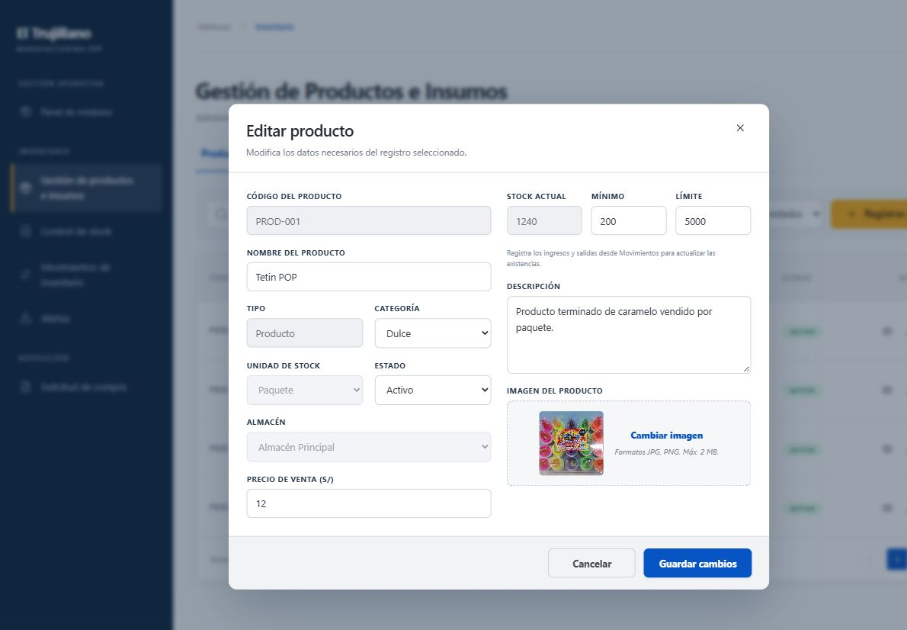
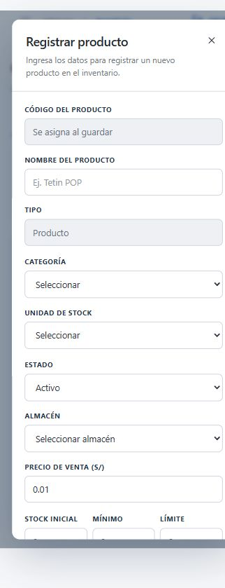

# Verificación histórica del frontend de inventario

Fecha: 3 de noviembre de 2026.

## Comprobaciones ejecutadas

- `npm run build:backend`: compilación de producción Angular correcta e integración de bundles con Spring. Carga inicial aproximada de 301 kB sin comprimir / 83 kB estimados en transferencia.
- `mvn clean test` y posterior `mvn test` tras corregir la entrada de la SPA: 20 pruebas aprobadas, 0 errores, 0 fallos y 0 omitidas. Incluye sesión persistida, logout, validación de imágenes y recarga de la ruta base.
- Contrato OpenAPI parseado y referencias de schemas verificadas. Recursos JS/CSS referidos por el HTML de producción existentes.

## Flujos comprobados en navegador contra Spring y H2

| Flujo | Resultado observado |
|---|---|
| Iniciar sesión como administrador | Menú completo y catálogo con datos del backend |
| Editar mínimo de Tetin POP | Nuevo mínimo persistido en la tabla |
| Registrar producto con imagen JPG | Producto creado, imagen guardada y stock inicial visible |
| Registrar insumo | Insumo creado con unidad, almacén y límites correctos |
| Salida de 3 unidades de un producto con 10 | Comprobante con saldo anterior 10 y posterior 7 |
| Preparar reposición automática | Insumos faltantes y cantidades sugeridas cargados en formulario |
| Enviar solicitud al proveedor elegido | Solicitud Pendiente y sus dos detalles persistidos |
| Eliminar producto con stock e historial | Estado Inactivo, saldo 7 conservado |
| Cerrar sesión e ingresar como jefe de compras | Menú restringido al ámbito permitido |
| Leer una notificación | Conteo pendiente reducido de 3 a 2 |
| Recargar la ruta del catálogo | Angular vuelve a cargar y conserva la sesión |
| Edición final | Unidad y almacén deshabilitados; saldo de consulta |
| Vista móvil | Formulario de una columna; ancho del documento igual al viewport, sin desbordamiento horizontal de la página |

Los registros usados en estos flujos pertenecen a una base H2 de vista previa. No se aplicaron migraciones ni cambios a una base Oracle remota.

## Evidencia visual

La compilación integrada descrita en este informe corresponde a la estructura anterior y ya no se usa. Actualmente el frontend se ejecuta desde el repositorio independiente `TrujillanosSAC-Frontend`; para iniciar la versión actual, seguir las instrucciones de `README.md` y `docs/inventario/README.md`.
